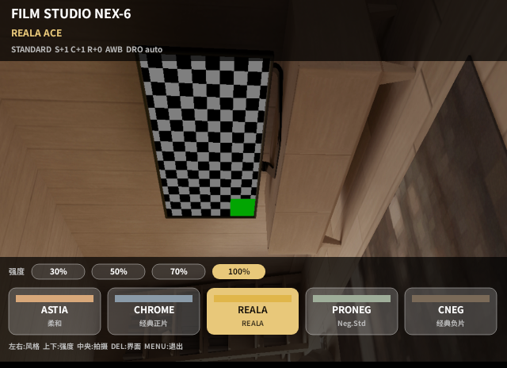
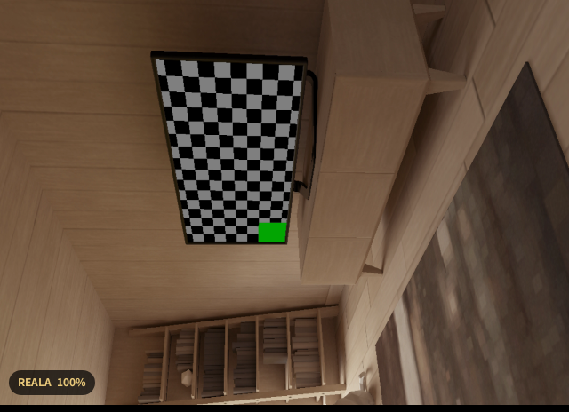
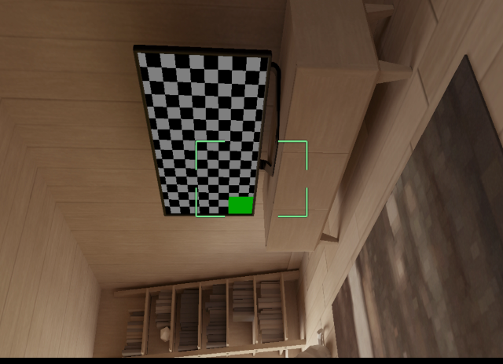
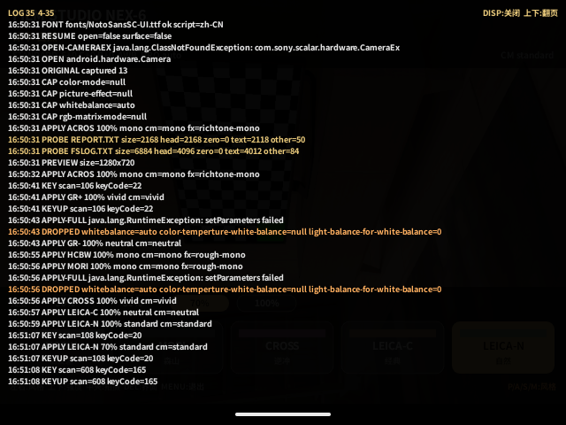

# Film Studio NEX-6

[中文](README.md) · **English**

A standalone, unofficial film-look app for the **Sony NEX-6**. It expresses the seventeen Film Studio looks with runtime camera parameters the NEX-6 actually accepts, draws its own control overlay over the live view, and restores the camera's original parameters on exit.

> **Status: `0.2.19-alpha` (versionCode 21), no readable NEX-6 hardware logs yet.** 0.2.13 did start on a NEX-6 and wrote its card files, but the retrieved `REPORT.TXT`/`FSLOG.TXT` arrived as all-NUL over MTP. A 0.2.15 check on hardware confirmed the missing premise: with the mode dial in iAuto / SCN the monochrome looks still rendered in color, while P produced grayscale — those auto modes hand Creative Style and Picture Effect back to the camera. 0.2.16 therefore adds an orange `P/A/S/M: STYLE` hint at the right of the bottom tips line and keeps the 0.2.15 dual mono path. 0.2.17 adds two Leica-reference looks (Classic, Natural), bringing the total to 17. 0.2.18 fixes the out-of-range color-temperature write (the camera used to receive K×100 values such as 560000): the four Kelvin looks no longer lock white balance and use AWB with an A-B shift instead, which should remove the yellow cast reported on CHROME/GR- and the blue cast on CNEG, pending hardware re-check. 0.2.19 adds a Neutral fallback: the NEX-6 generation has no Neutral Creative Style and Sony silently ignores unknown styles, so when the firmware's readable style list lacks `neutral` the seven neutral-based looks switch to Standard with an extra strength-scaled saturation cut, logged as `STYLE neutral fallback`. The build, API-10 static checks and Android 37 emulator smoke tests are complete; `camera_tested=false`. Until on-camera evidence exists, this project makes no compatibility or usability claim.

## Scope

- **Target**: Sony NEX-6, firmware 1.03, Android 2.3.7 / API 10.
- **Standalone app**: package `com.filmstudio.nex6`; it can coexist with the older a5100 Film Studio.
- **Still images only**: there is no movie UI; PLAY and MOVIE are ignored, and DISP toggles the on-screen log.
- **Runtime parameters only**: it writes `Camera.Parameters` and restores them on exit or pause; no firmware changes, no camera settings storage, no factory reset.
- **Parameter-level approximation**: the NEX-6 has no matrix/gamma or 3D LUT channel, so the result will not be pixel-identical to the a5100 build.

## Features

- 17 looks (10 Fujifilm-reference, 5 Ricoh-reference, 2 Leica-reference), 4 strengths (30 / 50 / 70 / 100%). **Set the mode dial to P / A / S / M first**: iAuto and SCN let the camera own the look, so B&W renders in color.
- The monochrome looks (ACROS / HCBW / MORI) write both Creative Style `mono` and a mono Picture Effect (`richtone-mono` / `rough-mono`): if the firmware drops one path, the other can still produce a grayscale frame. Both read-backs appear in the top-right corner as `CM … FX …`.
- An orange `P/A/S/M: STYLE` hint stays at the right of the full panel's bottom tips line. LEFT/RIGHT or the wheels switch looks; UP/DOWN change strength, with live-view feedback.
- Three-stage UI: full panel → bottom-left pill → live view only; DELETE or SK2 cycles.
- English, Simplified Chinese and Traditional Chinese UI following the system locale; bundled Noto Sans SC/TC subsets supply the CJK glyphs the firmware lacks.
- S1 half-press autofocus with an app-drawn focus frame (white searching, green locked, red failed).
- Center button or shutter captures a JPEG; the app checks `DCIM` for a new file and logs the result.
- The last look and strength are restored on the next launch.
- Card diagnostic snapshot at `/sdcard/FSNEX6/REPORT.TXT` (written on exit/crash, readable), with no IP address or serial number.

## Screenshots

> These are Android 37 emulator captures that show the layout, **not NEX-6 hardware**. The emulator has no Sony CameraEx and no real scene, so color, framing and AF position will differ on the camera.

| Full panel | Pill stage | Hidden view · S1 focus lock |
| --- | --- | --- |
|  |  |  |

The captures show the Simplified Chinese UI; English and Traditional Chinese use the same layout with different strings and fonts.

## Compatibility

| Model / firmware | Status |
| --- | --- |
| **NEX-6, firmware 1.03** | Development target; **not yet tested on hardware** |
| Other NEX-6 firmware | Not assessed; 1.03 results cannot be assumed |
| a5100 / ILCE-5100 | Not applicable; use the a5100 Film Studio instead |
| Other PMCA bodies | Not assessed; no support claim |

PMCA (PlayMemories Camera Apps) is the on-camera platform required to install this app. A successful install would not prove the features work; see the first-run checklist in [VALIDATION.md](docs/VALIDATION.md).

## Controls

| Key | Action |
| --- | --- |
| LEFT / RIGHT, wheels and dials | Previous / next look |
| UP / DOWN | Strength + / − |
| Center button, shutter | Capture |
| S1 half-press | Autofocus; release cancels |
| DELETE / SK2 | Cycle UI stage (full → pill → hidden) |
| MENU / SK1 | Restore parameters and exit |
| BACK | Restore parameters and exit |
| DISP | Open / close the on-screen log; UP/DOWN page it while open, BACK closes it |
| PLAY / MOVIE | Ignored |

## The 17 looks

| # | Tag | Name |
| --- | --- | --- |
| 0 | PROVIA | Fuji PROVIA Standard |
| 1 | VELVIA | Fuji Velvia Vivid |
| 2 | ASTIA | Fuji ASTIA Soft |
| 3 | CHROME | Fuji Classic Chrome |
| 4 | REALA | Fuji REALA ACE |
| 5 | PRONEG | Fuji PRO Neg. Std |
| 6 | CNEG | Fuji Classic Negative |
| 7 | ETERNA | Fuji ETERNA Cinema |
| 8 | BLEACH | Fuji ETERNA Bleach |
| 9 | ACROS | Fuji ACROS Mono |
| 10 | GR+ | Ricoh GR Positive |
| 11 | GR- | Ricoh Negative Film |
| 12 | HCBW | Ricoh Hi-Contrast B&W |
| 13 | MORI | Ricoh Moriyama Mono |
| 14 | CROSS | Ricoh Cross Process |
| 15 | LEICA-C | Leica Look Classic |
| 16 | LEICA-N | Leica Look Natural |

The per-look color mode, saturation, contrast, sharpness, white balance and DRO values are in [ARCHITECTURE.md](docs/ARCHITECTURE.md#5-17-个风格) (Chinese). Names describe the intended look only; they are not pixel-accurate matches to Fujifilm, Ricoh or Leica output.

## Installation

Prerequisites:

1. The NEX-6 app menu has been restored with the **sony-nex6-app-menu-unlock** procedure.
2. Wi-Fi ADB is enabled on the camera (Sony-PMCA-RE / OpenMemories: Tweak).
3. Android Platform-Tools are installed on the computer.

Download `FilmStudioNex6-0.2.19-alpha.apk` from the Releases page (built by CI on tag `0.2.19`), or use the local build at `output/FilmStudioNex6-0.2.19-alpha.apk`, then run:

```sh
adb connect CAMERA_IP:5555
adb -s CAMERA_IP:5555 install -r FilmStudioNex6-0.2.19-alpha.apk
```

`CAMERA_IP` is a placeholder; replace it with the address currently shown on the camera and keep the `:5555` port. Mask the real IP before sharing screenshots or logs.

SHA-256 of the current build:

```text
6450c4676599a1ca51c4e492f2ee31a56d2f37158a70c9b715789b07d385db6d
```

This SHA-256 belongs to the locally signed `output/` build. The CI release APK is signed with a throwaway debug key: its signature and checksum differ, so use the `SHA256SUMS.txt` attached to that release. The two cannot update each other in place.

See the **[English installation guide](docs/INSTALL.en.md)** for the full procedure, first-run checks, log retrieval and troubleshooting.

> **Do not** use the camera's Settings → Initialize to troubleshoot. The CN2 preset closes the app entry again and the unlock has to be repeated. The unlock parameters apply only to NEX-6 1.03 / `CX76001_CN2`, not to other models or regions.

## Logs

Look at the camera screen first: press **DISP** to open the on-screen log (the last 600 lines in memory), page it with UP/DOWN and press DISP or BACK to close; MENU still exits. It needs no card read and is the only channel that has worked on the NEX-6 so far, so a photo of the `PROBE`, `STYLE` and `DROPPED` lines is enough for a report.



> Captured on the Android 37 emulator to show the overlay layout; it is not a NEX-6 hardware screenshot.

The app still writes two files to the card:

```text
/sdcard/FSNEX6/REPORT.TXT   snapshot written once and closed on exit/crash
/sdcard/FSNEX6/FSLOG.TXT    append journal kept while running (crash residue)
```

Both names satisfy the Sony FUSE DOS 8.3 limit. Both files copied off a real NEX-6 over MTP and a remote-desktop session arrived as all-NUL, so reading the card files is not confirmed on hardware; 0.2.14 and later read the previous session back at startup and record `PROBE size=… zero=… text=…`, and again right after an export. If `PROBE` reports `text=0`, take `FSNEX6/REPORT.TXT` off the SD card with a **card reader** instead of MTP. Reopening the app within the same process keeps earlier lines, so `REPORT.TXT` covers the last few sessions (600-line cap). The card root is used only if the directory cannot be created. The log records body/firmware, preview size, key scan codes, parameter apply/drop results, Creative Style and Picture Effect read-backs (`CM … FX …`), capture, card-save checks, focus results and exceptions; it does **not** record IP addresses, serial numbers or image content.

Retrieve it with (exit the app normally first so `REPORT.TXT` is written):

```sh
adb -s CAMERA_IP:5555 pull /sdcard/FSNEX6/REPORT.TXT
```

If `REPORT.TXT` is missing or all-NUL, read the same path from the SD card with a card reader rather than copying over MTP.

## Building

Requirements: JDK 17, Android SDK build-tools 36.0.0, `platforms/android-37.0/android.jar`, OpenSSL and Python 3.

```sh
python3 tools/build.py
```

The APK is written to `output/FilmStudioNex6-0.2.19-alpha.apk` and a metadata file to `validation/FilmStudioNex6-0.2.19-alpha.json`. Signing uses the local `.private/signing.pem`, which is never committed or uploaded. If it is missing, the script signs with a throwaway debug key; that signature differs and cannot update an installed release in place.

GitHub Actions ([.github/workflows/build.yml](.github/workflows/build.yml)) runs the API-10 compile gate and builds the APK on every push and pull request, then uploads it as a workflow artifact. Pushing any tag (for example `0.2.17`) also creates a pre-release containing the APK, `SHA256SUMS.txt` and the validation JSON. CI has no signing key, so both the artifact and the release APK are debug-signed and are meant for testing only; they cannot update an installed local or release build.

To regenerate the Chinese font subsets (optional; needs network and `fonttools`):

```sh
python3 -m pip install fonttools
python3 tools/fetch_fonts.py
```

Full build, API-10 gate, emulator test and release notes are in [DEVELOPMENT.md](docs/DEVELOPMENT.md).

## Repository layout

```text
app/            Java sources, manifest, resources and bundled fonts
docs/           Installation, architecture, development, compatibility, validation, sources
tools/          Build, font generation and API-10 signer
validation/     Current build metadata and SHA-256 (camera_tested=false)
.github/        GitHub Actions build workflow
output/         Local build artifacts (git-ignored)
inputs/         Local toolchain and third-party inputs (git-ignored)
.private/       Signing key (git-ignored, never commit)
```

## Known limitations

- No hardware validation yet; preview, capture, card save, focus callbacks and exit restore are unconfirmed on a NEX-6.
- **The mode dial must stay on P / A / S / M**: iAuto and SCN hand Creative Style and Picture Effect back to the camera, so the look does not land. The bottom-right hint of the full panel reads `P/A/S/M: STYLE`.
- Parameter-level approximation, not a port of the a5100/a7R II matrix, gamma or LUT engine; the two Leica looks reference only the upstream naming and parameter direction.
- Looks apply only while the app is open; the native camera does not retain them.
- Some bodies may drop fine-tune or DRO parameters; the app falls back to the core subset and logs `DROPPED`.
- The focus frame is an app-centered indicator, not the body's selected AF point.
- Still images only; no movie recording.
- Preview aspect and orientation may need adjustment after hardware testing.

## License and credits

This project originated from, and thanks, [ukiki0718-netizen/sony-a5100-film-studio](https://github.com/ukiki0718-netizen/sony-a5100-film-studio): the a5100 Film Studio defined the first fifteen looks and the validation approach, and the NEX-6 shell is an independent rewrite built on that work. The two Leica looks reference the naming and parameter direction of [Chai-Yu/sony-a7r2-film-studio](https://github.com/Chai-Yu/sony-a7r2-film-studio); this repository contains none of that project's LUT, matrix or curve data.

Original code and documentation are under [PolyForm Noncommercial 1.0.0](LICENSE). `tools/sign_apk.py` is adapted from bonyback1/sony-pmca-ricoh-mod and remains Apache-2.0; the bundled Noto Sans subsets are SIL OFL 1.1. Recipe Lab and sony-lut-camera are GPL-3.0 and were used as behavioral/interface references only; no source was copied.

This repository contains no Sony firmware or base-app code, no official Fujifilm or Leica LUTs, no Ricoh matrix data and no signing private key. Sony, PlayMemories, FUJIFILM, Ricoh and Leica trademarks belong to their owners; this project is not affiliated with, certified by or endorsed by them.

See [LICENSING.md](LICENSING.md), [NOTICE](NOTICE) and [SOURCES.md](docs/SOURCES.md).

## Documentation

- [Installation guide (English)](docs/INSTALL.en.md) · [安装教程（中文）](docs/INSTALL.zh-CN.md)
- [Architecture](docs/ARCHITECTURE.md) (Chinese)
- [Development and build](docs/DEVELOPMENT.md) (Chinese)
- [Compatibility and limits](docs/COMPATIBILITY.md) (Chinese)
- [Validation records](docs/VALIDATION.md)
- [Sources](docs/SOURCES.md)
- [Changelog](CHANGELOG.md)
