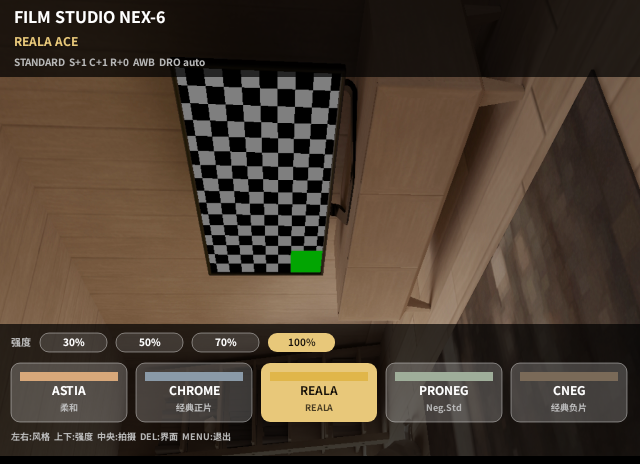
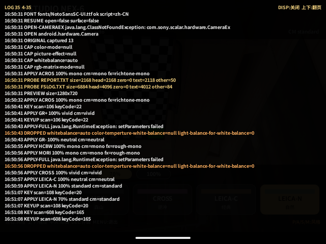
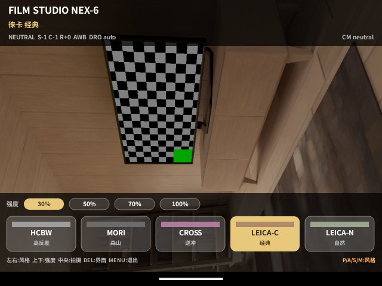
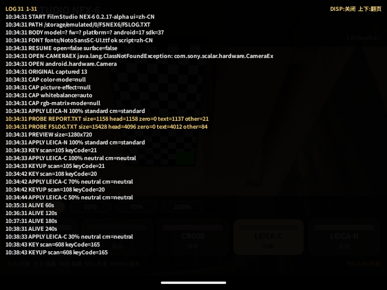
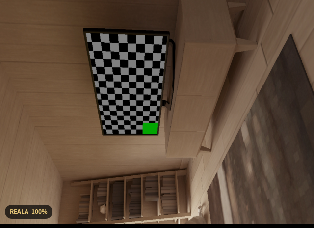
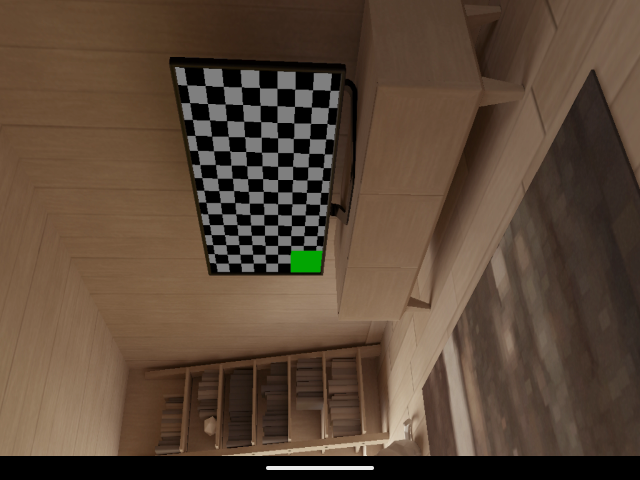
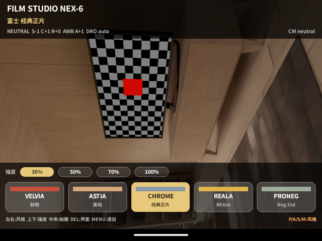
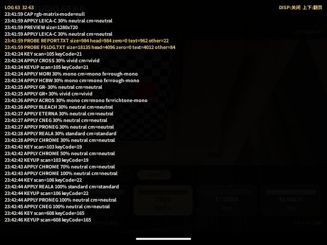

# 验证记录 / Validation

当前发布候选：`FilmStudioNex6-0.2.18-alpha.apk`（versionCode 20）

```text
SHA-256 42c8033706d1b36d7f20f5ee6adc2bbd2d47b6fe6e222f2cbd6621260e49c44d
size    81,094 bytes
```

> **`camera_tested=false`。** 0.2.13 已在用户的 NEX-6 上启动过，卡上确实生成了 `REPORT.TXT` 与 `FSLOG.TXT`；但两次经相机 USB/MTP 和远程桌面复制出来的文件都是 100% NUL，无法读取内容，因此取景、拍摄、落卡、对焦、色彩与退出恢复在实机上**均未被验证**。下面的静态检查和模拟器结果不能证明这些行为在相机上可用。
>
> 0.2.15 在用户实机上有一个口头确认的观察：拨盘在 **iAuto / SCN** 时黑白风格依旧出彩色，转到 **P** 后正常出灰阶——这两种自动模式由相机接管创意风格与照片效果。这是用户报告，不是可读日志证据；0.2.16 据此在完整面板底部右侧加入 `P/A/S/M` 提示。0.2.17 新增两个徕卡参考 Look，风格总数为 17。0.2.18 依据用户实机反馈（CHROME/理光负片偏黄、CNEG 偏蓝）修复色温写入越界 bug，风格不再锁色温，改为 AWB + A-B 微调。`camera_tested` 仍为 `false`。

## At a glance (English)

- **Build**: `com.filmstudio.nex6`, `0.2.18-alpha`, versionCode 20, minSdk/targetSdk 10, dex 035, 11 APK entries, 81,094 bytes, v1 JAR signature accepted for min-sdk 10.
- **Static**: all sources recompiled against the Android 2.3.3 (API 10) stub — 22 classes; the final dex references 35 `android.*` types and all 35 exist in the 2.3.3 stub; the resource table contains only `ic_launcher` and `app_name`; the APK contains dex code only, with no native libraries. The look table has 17 entries (10 Fujifilm-reference, 5 Ricoh/street, 2 Leica-reference). 0.2.18 removed the `wb`/`kelvin` fields and the color-temperature write path; UI strings and font subsets are unchanged.
- **Emulator**: Android 37 at 640×480/160 installed this exact artifact (with `--bypass-low-target-sdk-block`). In the Simplified Chinese UI the full panel reached `LEICA-C` (`徕卡 经典`, card 16) and `LEICA-N` (`徕卡 自然`, card 17) without tofu, and the log recorded `APPLY LEICA-C 100% neutral cm=neutral`, `APPLY LEICA-N 100% standard cm=standard` and `APPLY LEICA-N 70% standard cm=standard`. The `P/A/S/M:风格` hint remained on the bottom tips line. Traditional Chinese showed `徠卡 自然` and English showed `LEICA-N Leica Look Natural`; the English run hit the emulator's intermittent camera-open failure, which is not an app crash. DISP opened the in-memory log (`LOG 35 4-35`) and MENU exited with `RESTORE ok`; the resulting `REPORT.TXT` was 2,016 bytes, 43 lines, 0 NUL. A second cold-boot session on 2026-11-10 stepped `LEICA-C` through 100/70/50/30% (highlighted chips plus four `APPLY LEICA-C <pct>% neutral cm=neutral` lines), exercised pill (`LEICA-C 经典 30%`), hidden and full stages, and exited with `RESTORE ok`; its `REPORT.TXT` was 1,667 bytes, 44 lines, 0 NUL. The 0.2.18 re-check (2026-11-10) confirmed the white-balance fix: `CHROME`/`GR-` and `CNEG`/`CROSS` now write `whitebalance=auto` with A-B +1/+2 instead of a color temperature, the parameter line reads `AWB A+1`, the log shows `APPLY CHROME 30/50/70/100% neutral cm=neutral` and `APPLY CNEG 100% neutral cm=neutral`, no `color-temperture-white-balance` write appears anywhere, and the session `REPORT.TXT` was 3,080 bytes, 72 lines, 0 NUL. The fake camera echoes values and cannot prove NEX-6 firmware accepts the Leica parameter set.
- **Hardware**: two user-supplied NEX-6 sessions produced plausible card files (`REPORT.TXT` 2,853 B, `FSLOG.TXT` 21,562 B) but every copied byte was NUL. A later 0.2.15 session produced the mode-dial observation above (user report only). On 2026-11-10 the user reported on hardware that CHROME/GR- rendered too yellow and CNEG too blue — consistent with the pre-0.2.18 out-of-range color-temperature write (K×100); no readable log accompanies this report. No behavior is log-verified; `camera_tested=false`.

## 1. 当前构建

| 项目 | 结果 |
| --- | --- |
| 包名 | `com.filmstudio.nex6` |
| 版本 | `0.2.18-alpha` / versionCode 20 |
| 显示名 | Film Studio NEX-6 |
| minSdk / targetSdk | 10 / 10 |
| dex | `dex\n035` |
| APK 条目 | 11 |
| 大小 | 81,094 bytes |
| SHA-256 | `42c8033706d1b36d7f20f5ee6adc2bbd2d47b6fe6e222f2cbd6621260e49c44d` |
| 签名 | v1 JAR，SHA-1，RSA；`apksigner verify --min-sdk-version 10` 通过 |
| 证书 | `CN=SonyPMCADebug`（本地开发证书，SHA-256 `72f30a1a…d133`） |
| 资源表 | 仅 `drawable/ic_launcher`、`string/app_name` |
| 字体 | `NotoSansSC-UI.ttf` 33,420 B；`NotoSansTC-UI.ttf` 36,488 B；各附 OFL 1.1 |
| `camera_tested` | **false** |

`0.2.18` 是白平衡修复版，风格表与 0.2.17 相同（17 个）：

1. **Bug**：0.2.17 及之前，带色温的风格把 `color-temperture-white-balance` 写成 K×100（`5600` → `560000`），远超 Sony 公布的 2500–9900 范围；模拟器假相机原样回显、从不校验，实机固件行为不可预测。用户实机反馈：`CHROME`/`GR-` 明显偏黄、`CNEG` 明显偏蓝；
2. **修复**：风格不再锁色温。17 个风格一律写 `whitebalance=auto`；`CHROME`/`GR-` 用 A-B +1，`CNEG`/`CROSS` 用 A-B +2（琥珀为正、直接写入、写后回读，被固件丢弃则记入 `DROPPED`）。方向对齐 a5100 上游的「滤镜不会锁定白平衡」；
3. **界面**：顶部参数行由 `5600K A+1` 变为 `AWB A+1`；低强度对 A-B 的线性缩放不变（30%/50% 时 ±1/±2 舍入为 0/1）；
4. **代码**：删除 `wb`/`kelvin` 字段与色温写入路径；用户自己的色温参数仍随原参数捕获并在退出时恢复；不新增类，界面文案与字体子集不变；
5. **版本**：Manifest 升至 `0.2.18-alpha` / versionCode 20，`tools/build.py`、CI 产物名与文档同步，`validation/` 只保留本版 JSON。

`0.2.16` 的底部 `P/A/S/M` 模式提示与 `0.2.15` 的黑白双路径保持不变：ACROS/HCBW/MORI 同时写 `color-mode=mono` 和单色 `picture-effect`（ACROS 为 `richtone-mono`，HCBW/MORI 为 `rough-mono`），两值都回读；未单色时先轮换 `mono` 别名重试 `color-mode`，仍失败再重试效果。照片效果开启时 Sony 忽略创意风格滑块，黑白强度可能不再改变对比，这是为保证灰阶接受的取舍。

下面的静态检查针对最终 `42c80337…c44d` 执行；第 3.1–3.5 节是 0.2.17 构建（`2e0a3be4…464d`）的模拟器记录，3.6 为 0.2.18 白平衡修复后的复验。

## 2. 静态验收

### 2.1 API 10 编译门

全部源码用 Android 2.3.3 公开 stub 重新编译：

```text
javac -source 8 -target 8
-bootclasspath /tmp/android-2.3.3.jar:$ANDROID_HOME/platforms/android-37.0/android.jar
app/src/com/filmstudio/nex6/*.java
```

结果：22 个 class（含内部类），编译通过。`0.2.18` 只删除 `Looks` 的 `wb`/`kelvin` 字段与 `Cam` 的色温写入分支，不新增类，class 数与 0.2.17 相同。任何 API 11+ 的 `android.*` 类型或方法都会在这一步失败；此前的 `KEYCODE_FORWARD_DEL`（API 11）就是这样被发现并移除的。

### 2.2 dex 类型审计

对最终 `classes.dex` 运行 `dexdump -d`，提取全部 `android.*` 类型并与 2.3.3 stub 的 `classes.jar` 比对：

```text
android refs: 35
missing in 2.3.3 stub: 0
```

35 个类型包括 `Activity`、`Context`、`SharedPreferences`、`PackageManager`、`AssetManager`、`Camera` 及其 `AutoFocusCallback`/`Parameters`/`PictureCallback`/`ShutterCallback`/`Size`、`Canvas`、`Paint`、`Rect`、`RectF`、`Typeface`、`Build.VERSION`、`Bundle`、`Environment`、`Handler`、`SystemClock`、`Log`、`KeyEvent`、`SurfaceHolder`/`Callback`、`SurfaceView`、`View`、`ViewGroup.LayoutParams`、`Window`、`FrameLayout`/`LayoutParams`。

### 2.3 资源与清单

- `aapt dump badging`：包名、版本、minSdk/targetSdk 和标签如上表；
- 清单不含 `android:compileSdkVersion` / `platformBuildVersion`（`aapt2 --no-compile-sdk-metadata`）；
- 资源表只有启动图标和应用名，无 framework 私有 ID 引用；
- `classes.dex` 魔数 `dex\n035`；
- v1 签名文件 `META-INF/MANIFEST.MF`、`CERT.SF`、`CERT.RSA` 均存在。

### 2.4 字体

`Lang.java` 的界面文本按简/繁分别生成子集：

```text
NotoSansSC-UI.ttf  33,420 B  167 请求字符（95 ASCII + 72 简体）
NotoSansTC-UI.ttf  36,488 B  168 请求字符（95 ASCII + 73 繁体）
```

逐字校验：SC 字体包含全部简体用字，TC 字体包含全部繁体用字；SC 字体只缺繁体变体，TC 字体只缺简体变体（预期）。0.2.17 新增的 `富士`、`徕卡`/`徠卡`、`自然` 与 `经典`/`經典` 已逐字确认在对应 cmap 中，APK 内字体与 `app/assets/` 字节一致。0.2.18 参数行由 `5600K` 变为 `AWB`（纯 ASCII），界面文案不变，字体子集字节不变。0.2.14 的简体启动记录仍然适用：

```text
FONT fonts/NotoSansSC-UI.ttf ok script=zh-CN
```

0.2.14 已验证简体界面与 DISP 叠加层提示 `DISP:关闭 上下:翻页` 渲染正常、无豆腐块；0.2.17 在简体中文界面下确认 `徕卡 经典`、`徕卡 自然` 与卡片短名 `经典`/`自然` 无豆腐块，繁体界面确认 `徠卡 自然`，英文界面确认 `LEICA-N Leica Look Natural`。繁体与英文只做了模拟器截图检查，未覆盖全部排版。

## 3. 模拟器冒烟测试

环境：Android 37 模拟器 `emulator-5554`，`wm size 640x480`、`wm density 160`。安装命令带 `--bypass-low-target-sdk-block`，因为 Android 37 会拒绝 targetSdk 10 的普通安装；这只是模拟器的限制，不是 NEX-6 的要求。

### 3.1 启动、取景与界面提示

安装后以简体中文启动，先停在持久化的 ACROS，再按右键切到 `LEICA-C` 与 `LEICA-N`。`REPORT.TXT` 中的 0.2.17 会话（节选）：

```text
START FilmStudio NEX-6 0.2.17-alpha ui=zh-CN
FONT fonts/NotoSansSC-UI.ttf ok script=zh-CN
PATH /storage/emulated/0/FSNEX6/FSLOG.TXT
BODY model=? fw=? platform=? android=17 sdk=37
OPEN android.hardware.Camera
ORIGINAL captured 13
CAP color-mode=null
CAP picture-effect=null
CAP whitebalance=auto
CAP rgb-matrix-mode=null
APPLY ACROS 100% mono cm=mono fx=richtone-mono
PREVIEW size=1280x720
APPLY LEICA-C 100% neutral cm=neutral
APPLY LEICA-N 100% standard cm=standard
APPLY LEICA-N 70% standard cm=standard
RESTORE ok
END app
EXPORT /storage/emulated/0/FSNEX6/REPORT.TXT
```

截图确认：

- `LEICA-C` 顶部显示 `徕卡 经典`，卡片序号 16，参数行 `NEUTRAL S-1 C-1 R+0 AWB DRO auto`，右上角 `CM neutral`；
- `LEICA-N` 顶部显示 `徕卡 自然`，卡片序号 17，参数行 `STANDARD S+0 C+0 R+0 AWB DRO auto`，右上角 `CM standard`；
- 两次切换都无豆腐块，底部右侧橙色 `P/A/S/M:风格` 仍与左侧按键提示同一基线、无重叠；按上/下键把 `LEICA-N` 从 100% 降到 70% 后，参数行仍为 `standard`，日志给出 `APPLY LEICA-N 70% standard cm=standard`。



`cm=neutral` / `cm=standard` 是模拟器假相机的回读：它原样接收并回显写入值。NEX-6 是否以同样的参数组合呈现徕卡参考观感，仍只能由实机判断；本版也没有复制上游的矩阵、Gamma 或 LUT。

### 3.2 屏内日志

按 DISP（模拟器映射 keyCode 165）打开叠加层，截图确认：

- 标题 `LOG 35 4-35`，右上角提示 `DISP:关闭 上下:翻页`（简体中文界面）；
- 覆盖层显示两次会话共 35 行，包括 `START ... 0.2.17-alpha ui=zh-CN`、`APPLY LEICA-C 100% neutral cm=neutral`、`APPLY LEICA-N 100% standard cm=standard`、`APPLY LEICA-N 70% standard cm=standard` 与 `KEY scan=608 keyCode=165`；
- 再按 DISP 关闭，回到主界面；MENU 退出仍生效。提示与翻页文案沿用 0.2.14 的实现，本次未改代码。

日志打开时，UP/DOWN 用于翻页（长按 ×3），MENU 退出、BACK 关闭，其余按键由 `onKeyDown` 吞掉，避免误改风格。



### 3.3 MENU 退出、恢复与日志回读

```text
KEY scan=514 keyCode=82
KEYUP scan=514 keyCode=82
EXIT menu
RESTORE ok
PAUSE released finishing=true
END app
EXPORT /storage/emulated/0/FSNEX6/REPORT.TXT
```

`dumpsys window` 显示前台回到 launcher，应用正常结束。第一轮简体中文会话的 `REPORT.TXT` 为 2,016 字节、43 行、0 个 NUL；`adb pull /sdcard/FSNEX6/REPORT.TXT` 取回的 UTF-8 文本包含 `RESTORE ok`、`END app` 与 `EXPORT /storage/emulated/0/FSNEX6/REPORT.TXT`。这验证了导出与回读链路本身在 Android 37 上通过；它**不**代表 Sony FUSE 或相机 USB/MTP 的读取行为。

### 3.4 简/繁/英界面

同一构建分别设置 `zh-TW` 与 `en-US` 后强制停止并重启：

- 繁体界面顶部显示 `徠卡 自然`，卡片短名 `自然`，完整面板与底部提示无豆腐块；
- 英文界面顶部显示 `LEICA-N Leica Look Natural`，底部提示为 `LEFT/RIGHT: look UP/DOWN: strength CENTER: shoot DEL: UI MENU: exit`，右侧为 `P/A/S/M: STYLE`；
- 英文会话重启时模拟器偶发 `camera open failed: java.lang.RuntimeException: Fail to connect to camera service`（应用显示的相机未就绪提示），界面与参数行仍正常绘制，未崩溃；这是模拟器相机服务的已知间歇问题，不是应用异常。

### 3.5 LEICA-C 低强度与三阶段 UI（第二轮会话）

`2026-11-10` 在同一最终构建（`2e0a3be4…464d`）上冷启动第二轮模拟器会话（简体中文，640×480/160），补验 `LEICA-C` 的低强度与最小界面：

- 选中 `LEICA-C` 后按 DOWN 逐档降强度：100% → 70% → 50% → 30%，每档截图确认高亮芯片与档位一致；
- 顶部参数行保持基签名 `NEUTRAL S-1 C-1 R+0 AWB DRO auto`：`UiView` 绘制的是未缩放的基础参数，强度只通过芯片、胶囊与 `APPLY` 日志体现，降强度不改变该行文案；
- DISP 叠加层与 `REPORT.TXT` 一致给出四条应用记录（假相机回读）：

```text
APPLY LEICA-C 100% neutral cm=neutral
APPLY LEICA-C 70% neutral cm=neutral
APPLY LEICA-C 50% neutral cm=neutral
APPLY LEICA-C 30% neutral cm=neutral
```

- `LEICA-C` 的饱和/对比只有 −1 档：按 `Looks.atStrength` 的线性缩放四舍五入，70% 保留 −1，50%/30% 舍入为 0；创意风格与 DRO 不插值。模拟器只回读创意风格，滑块在固件上的接受情况仍待实机；
- DEL 切到胶囊：左下角显示 `LEICA-C 经典 30%`（短名 + 当前强度）；再按 DEL 进入隐藏阶段，画面无任何覆盖元素；再按 DEL 回到完整面板。日志依次记 `UI pill` / `UI hidden` / `UI full`；
- MENU 退出：`EXIT menu` → `RESTORE ok` → `PAUSE released finishing=true` → `END app` → `EXPORT`。该会话 `REPORT.TXT` 为 1,667 字节、44 行、0 个 NUL。









### 3.6 0.2.18 白平衡修复复验

`2026-11-10` 在 0.2.18 构建（`42c80337…c44d`）上冷启动，简体中文，640×480/160：

- 切到 `CHROME`：顶部参数行 `NEUTRAL S-1 C+1 R+0 AWB A+1 DRO auto`，不再有 `5600K` 字样；
- 强度 30% → 50% → 70% → 100% 依次记录 `APPLY CHROME 30/50/70/100% neutral cm=neutral`；切到 `CNEG` 记录 `APPLY CNEG 100% neutral cm=neutral`；
- 整份 `REPORT.TXT` 无 `color-temperture-white-balance` 写入、无 `SET-` 失败；假相机原样回显 `light-balance-for-white-balance`，因此没有 `DROPPED` 行——实机固件是否保留 A-B 偏移仍未知；
- MENU 退出 `RESTORE ok`；该会话 `REPORT.TXT` 3,080 字节、72 行、0 个 NUL。





### 3.7 模拟器不能验证的内容

- NEX-6 的真实 Sony 扫描码、拨轮方向和 S1/S2 行为；模拟器没有 DISP 的原始扫描码，只能用 keyCode 165 经 `fallback()` 映射为 608（日志仍记 `scan=608`）；
- 真实拨盘位置与 iAuto/SCN 下相机接管风格的固件行为；模拟器没有模式拨盘，`P/A/S/M` 提示的语义只能由实机确认；
- CameraEx 的 `takePicture` 落卡时序与 `cancelTakePicture`；
- `color-mode=mono` 与 `picture-effect=richtone-mono/rough-mono` 在 NEX-6 固件上的实际接受情况（模拟器假相机会回显任意值，且不公布效果值）；
- A-B/G-M 微调、DRO 在 NEX-6 固件上的实际接受情况（0.2.18 起风格不再写色温）；
- 预览比例、方向和快门后的恢复；
- 对焦失败（红色）路径；
- 退出后原生取景的颜色恢复；
- 繁体系统语言下的实际字体渲染（仅做字符覆盖校验）；
- 640×480 以外的排版；
- Sony FUSE 上 `REPORT.TXT` / `FSLOG.TXT` 的读取结果（这正是 0.2.14 起的 `PROBE` 要在实机上回答的问题）。

## 4. 实机证据

**行为未验证。** `2026-11-09`，用户在 NEX-6 上启动过 0.2.13：

- 卡上生成了 `FSNEX6/REPORT.TXT`（2,853 B）和 `FSNEX6/FSLOG.TXT`（21,562 B，较上一轮 18,710 B 增长）；
- 两份文件经相机 USB/MTP 与 Windows 远程桌面复制到电脑后，逐字节检查均为 100% NUL，无可打印文本；
- 因此无法确认取景、覆盖层、风格、拍摄、落卡、对焦或退出恢复中的任何一项。

文件大小合理且持续增长，说明应用在实机上确实运行并写入了内容；问题出在读取/传输路径或 Sony FUSE 的回写行为。`camera_tested` 必须保持 `false`。

### 4.1 用户实机观察：模式拨盘（0.2.15）

`2026-11-09`，用户在 NEX-6 上安装 0.2.15 后反馈黑白风格仍出彩色；把拨盘从 **iAuto / SCN** 转到 **P** 后，黑白正常显示灰阶。结论：这两种自动模式由相机接管创意风格与照片效果，应用写入的 `color-mode=mono` 与单色效果不会落地；这是固件行为，不是参数写入失败。

这条观察来自用户口述与屏上画面，不是可读日志，因此：

- 它**是**目前唯一指向“P/A/S/M 下风格参数实际生效”的实机线索；
- 它**不足以**把 `camera_tested` 改为 `true`，落卡、对焦、拍摄与退出恢复仍未验证；
- 0.2.16 因此在完整面板底部右侧加入 `P/A/S/M:风格` 提示，并在 README / INSTALL / COMPATIBILITY 中写明拨盘要求。

### 4.2 0.2.18 实机首轮检查

0. 先把模式拨盘置于 **P / A / S / M**，确认底部右侧显示 `P/A/S/M:风格`；iAuto / SCN 下提示仍在，但风格不会生效；
1. 启动后按 DISP，确认屏内日志出现，并记录 `CAP picture-effect=…`；
2. 依次选择 ACROS / HCBW / MORI，记录右上角的 `CM … FX …`，并对屏内日志拍照：
   - 两者都是单色（如 `CM mono FX richtone-mono`）：两路至少一路生效；
   - `CM standard FX off`：两路都被固件丢弃，记录 `APPLY`、`DROPPED`，看是否有 `MONO retry …`；
   - 只有其一为单色：另一路被丢弃，仍应以灰阶为准；
3. 记录 `PROBE REPORT.TXT ... text=…` 与 `PROBE FSLOG.TXT ... text=…`；
4. 遍历 17 个风格/4 档强度，记录 `APPLY` / `DROPPED` / `STYLE` / `EFFECT`；重点新增 `LEICA-C`（`neutral`，`S-1 C-1 R+0`）与 `LEICA-N`（`standard`，`S+0 C+0 R+0`），确认相机接受 `neutral` / `standard` 且成片有可辨差异，不要求与上游 LUT 逐像素一致；注意照片效果开启时创意风格滑块被忽略，黑白强度可能不改变对比；0.2.18 另需重点核对 `CHROME`/`GR-`（AWB A+1）与 `CNEG`/`CROSS`（AWB A+2）：此前反馈的偏黄/偏蓝应消失，成片跟随 AWB，并检查 `DROPPED` 是否出现 `light-balance-for-white-balance`；
5. 半按 S1、中央键/快门拍摄，检查成片是否为灰阶，记录 `FOCUS` 与 `SAVED`；
6. 三阶段 UI、简/繁中文；
7. MENU/BACK 退出并恢复；
8. 若 `PROBE` 显示 `text=0`，用读卡器直接复制卡上的 `FSNEX6/REPORT.TXT`。

只有完成并保存证据后，才能把 `camera_tested` 改为 `true`，并在 README 中使用“已验证”“可用”等表述。

## 5. 版本历史

| 版本 | versionCode | 大小 | SHA-256（前 12 位） | 主要内容 |
| --- | --- | --- | --- | --- |
| 0.1.0-alpha | 1 | 22,057 | `4cc9a6f6c678` | 首个独立外壳；15 风格、拍摄、日志 |
| 0.2.0-alpha | 2 | 61,764 | `3afd5a379ec4` | 三阶段 UI、简/繁/英、`FSNEX6/` 日志 |
| 0.2.1-alpha | 3 | 71,700 | `8166b779da31` | 紧凑面板、本地化风格名 |
| 0.2.2-alpha | 4 | 71,766 | `1a187e51a96d` | 胶囊本地化 |
| 0.2.3-alpha | 5 | 71,763 | `de0ea4e42b09` | 切换浮层本地化 |
| 0.2.4-alpha | 6 | 71,834 | `ccdd319b1de4` | hidden 阶段强度反馈 |
| 0.2.5-alpha | 7 | 71,853 | `be6e0f2d8bc3` | 胶囊移到左下角 |
| 0.2.6-alpha | 8 | 71,932 | `ca0f06744d4f` | 字体加载诊断日志 |
| 0.2.7-alpha | 9 | 71,926 | `d6f188c780c4` | 底部提示行居左 |
| 0.2.8-alpha | 10 | 71,959 | `ae36d1284373` | 强度整行居左 |
| 0.2.9-alpha | 11 | 71,935 | `35ae4b99976e` | 左右切风格、上下切强度 |
| 0.2.10-alpha | 12 | 71,937 | `e27706edc403` | 风格卡更扁、与提示行拉开 |
| 0.2.11-alpha | 13 | 72,030 | `4b3273c577b7` | 卡片上下间距对称 |
| 0.2.12-alpha | 14 | 73,408 | `51889474607a` | S1 半按对焦框；目录重组后重建 |
| 0.2.13-alpha | 15 | 74,199 | `6c7121259561` | 修复日志全 NUL：退出/崩溃导出可读 REPORT.TXT 快照 |
| 0.2.14-alpha | 16 | 78,302 | `95e0292f7314` | DISP 屏内日志、回读探针、color-mode 回读与重试 |
| 0.2.15-alpha | 17 | 79,207 | `eccb2b1e31f5` | 黑白双路径：`mono` + 单色照片效果、别名解析与回读重试 |
| 0.2.16-alpha | 18 | 79,339 | `5cc4e4da0777` | 完整面板底部右侧 `P/A/S/M` 模式提示（iAuto/SCN 会接管风格） |
| 0.2.17-alpha | 19 | 81,270 | `2e0a3be4ab88` | 新增徕卡参考 Look `LEICA-C` / `LEICA-N`，风格总数 17；重生成字体子集 |
| **0.2.18-alpha** | **20** | **81,094** | **`42c8033706d1`** | **修复色温 ×100 越界写入；CHROME/GR-/CNEG/CROSS 改为 AWB + A-B 偏移** |

当前版本的完整元数据在 `validation/FilmStudioNex6-0.2.18-alpha.json`，记录 `camera_tested=false`。历史版本只保留上表摘要，完整旧 JSON 存放在本地 `legacy/validation-history/`，不随仓库发布。

早期“给 a5100 APK 打补丁”的 NEX-6 路线（0.3.x-alpha-nex6）不属于本仓库，源码和验证资料保存在本地 `legacy/a5100/`，不随新仓库发布。

## 6. 日志与复现

- 首选：相机屏上按 DISP 查看内存日志（最近 600 行）；
- 卡上：`/sdcard/FSNEX6/REPORT.TXT`（退出/崩溃快照）；`FSLOG.TXT` 为运行期间追加日志；
- 回读：启动 `PROBE`、导出后 `EXPORT-VERIFY`，报告 `size/head/zero/text/other`；
- 取回：`adb pull /sdcard/FSNEX6/REPORT.TXT`；若为全 NUL，用读卡器直接取卡；
- 构建：`python3 tools/build.py`；
- API 10 门禁与模拟器步骤：见 [DEVELOPMENT.md](DEVELOPMENT.md)。

日志不含 IP 地址或序列号。模拟器结果不替代实机验证。
